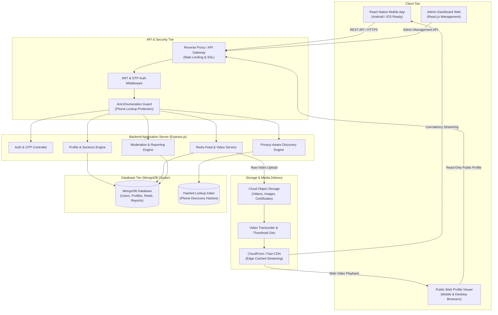
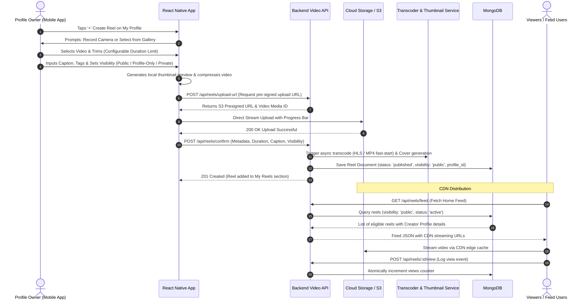
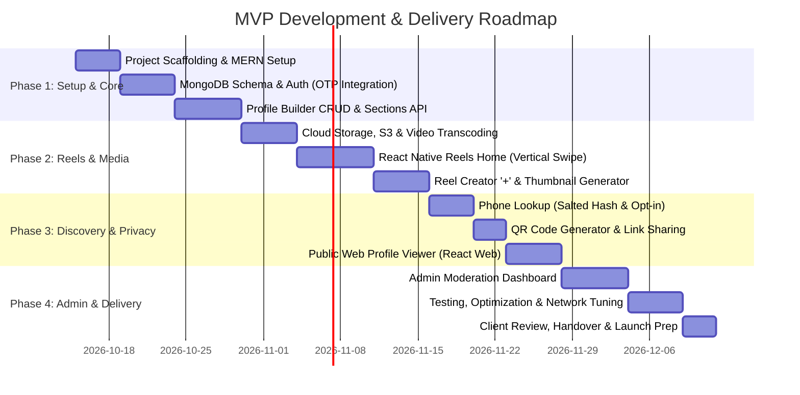

# Personal Digital Profile App (MyProfile) — Architecture Blueprint & Implementation Plan

> **Document Type:** Client-Ready Technical Specification & Implementation Plan  
> **Specification Version:** Version 2 (Revised MVP Developer Brief)  
> **Technology Stack:** MERN Stack (MongoDB, Express.js, React.js, Node.js) + React Native (Android / Cross-Platform)  
> **Repository Structure:** 3 Decoupled Tiers (`/backend`, `/frontend`, `/mobile-app`)  
> **Component Architecture:** Reusable, Repeatable Component-Based Pattern  

---

## 1. Executive Summary & Specification Review

All **12 specification pages** provided in the document (*Personal Digital Profile App - Revised Developer Product Brief & MVP Functional Specification v2*) have been systematically read, analyzed, and mapped.

### 1.1 Core Vision & Principle
The application is built around the fundamental paradigm:
$$\text{One Person} \longrightarrow \text{One Profile} \longrightarrow \text{One Shareable Identity} \longrightarrow \text{Optional Reels \& Social Engagement}$$

Unlike legacy social networks that prioritize infinite content feeds over identity, or portfolio website builders that feel rigid and intimidating to regular users:
- **At the front:** It feels like a modern, engaging social app where users open straight into full-screen vertical short-form reels.
- **At the core:** It is a permanent digital identity/profile platform that can be shared via custom username/slug, QR code, direct link, or protected mobile number lookup.
- **Zero-Barrier:** Ordinary users can create a professional, shareable profile in minutes without any coding, hosting, or technical knowledge.
- **Optional Reels:** Reels are an optional social layer. Users are never forced to produce reels to maintain their profile.

---

## 2. System Architecture & 3-Tier Folder Structure

The project is organized into three distinct, decoupled directories to ensure clear separation of concerns, maximum reusability of components, and clean deployment workflows.

```
job-demoapp/
├── backend/                  # Node.js + Express + MongoDB REST API & Media Microservices
├── frontend/                 # React.js Admin Moderation Panel & Public Web Profile Viewer
└── mobile-app/               # React Native (Android MVP, iOS-ready) Client Application
```

### 2.1 Backend Directory Structure (`/backend`)
```
backend/
├── src/
│   ├── config/               # DB connection, Cloudinary/S3, OTP provider, Redis/JWT
│   ├── controllers/          # Business logic handlers
│   │   ├── auth.controller.js
│   │   ├── profile.controller.js
│   │   ├── reel.controller.js
│   │   ├── discovery.controller.js
│   │   ├── admin.controller.js
│   │   └── report.controller.js
│   ├── middlewares/          # Auth guards, role checks, rate limiters, file uploads
│   │   ├── auth.middleware.js
│   │   ├── rateLimiter.middleware.js
│   │   ├── upload.middleware.js
│   │   └── validation.middleware.js
│   ├── models/               # Mongoose schemas
│   │   ├── User.js
│   │   ├── Profile.js
│   │   ├── Section.js
│   │   ├── Media.js
│   │   ├── Reel.js
│   │   ├── ReelEngagement.js
│   │   ├── PrivacySetting.js
│   │   ├── ProfileLookup.js
│   │   └── Report.js
│   ├── routes/               # API route declarations
│   │   ├── auth.routes.js
│   │   ├── profile.routes.js
│   │   ├── reel.routes.js
│   │   ├── discovery.routes.js
│   │   ├── admin.routes.js
│   │   └── public.routes.js
│   ├── services/             # Third-party integrations & domain services
│   │   ├── otp.service.js    # SMS OTP gateway (Twilio / MSG91 / Fast2SMS)
│   │   ├── storage.service.js# S3 / Cloudinary upload, transcoding & thumbnail gen
│   │   ├── qr.service.js     # QR code generation engine
│   │   └── moderation.service.js
│   ├── utils/                # Helpers, slugifiers, phone number normalizers
│   └── server.js             # Application entrypoint
├── tests/
├── .env.example
├── package.json
└── README.md
```

### 2.2 Frontend Directory Structure (`/frontend`)
The `frontend` houses the **Admin Management Dashboard** and the **Public Web Profile Pages** (viewable by external visitors on any web browser without needing to install the app).

```
frontend/
├── public/                   # Static assets, branding logos, favicons
├── src/
│   ├── assets/               # Icons, styles, brand graphics
│   ├── components/           # Modular, repeatable atomic UI components
│   │   ├── common/           # Generic reusable components
│   │   │   ├── Button/
│   │   │   ├── Input/
│   │   │   ├── Modal/
│   │   │   ├── Card/
│   │   │   ├── Badge/
│   │   │   └── Table/
│   │   ├── public-profile/   # Components rendered on public web profiles
│   │   │   ├── ProfileHeader/
│   │   │   ├── BioSection/
│   │   │   ├── SectionCard/
│   │   │   ├── ReelThumbnailGrid/
│   │   │   ├── ReelModalPlayer/
│   │   │   ├── ContactActionSheet/
│   │   │   ├── SocialLinkIcons/
│   │   │   └── ShareQrModal/
│   │   └── admin/            # Components for admin operations
│   │       ├── MetricCard/
│   │       ├── ModerationQueueTable/
│   │       ├── UserFilterToolbar/
│   │       └── MediaReviewPlayer/
│   ├── hooks/                # Custom React hooks (useAuth, usePublicProfile, usePagination)
│   ├── layouts/              # AdminLayout, PublicProfileLayout, AuthLayout
│   ├── pages/                # Routed views
│   │   ├── admin/            # Dashboard, UserManagement, ReelModeration, Reports
│   │   ├── public/           # ProfileView (`/:username`), NotFound
│   │   └── auth/             # AdminLogin
│   ├── services/             # API client methods (axios instances, interceptors)
│   ├── store/                # State management (Zustand / Redux Toolkit)
│   ├── utils/                # Date formatters, sharing links, download triggers
│   ├── App.jsx
│   └── main.jsx
├── package.json
└── vite.config.js
```

### 2.3 Mobile App Directory Structure (`/mobile-app`)
Built with **React Native** (optimized for Android performance and Indian networks, fully cross-platform for future iOS rollout).

```
mobile-app/
├── src/
│   ├── assets/               # Fonts, local placeholders, lottie animations
│   ├── components/           # Component-based reusable UI architecture
│   │   ├── atoms/            # Typography, AppButton, AppTextInput, Avatar, IconBadge
│   │   ├── molecules/        # SectionItem, MetricCounter, SearchInput, PrivacyToggle
│   │   ├── organisms/
│   │   │   ├── ReelPlayerItem/       # Vertical full-screen video player with controls
│   │   │   ├── ReelCreatorModal/     # Video trim, cover picker, caption input
│   │   │   ├── ProfileHeaderCard/    # User photo, handle, completion bar
│   │   │   ├── ProfileSectionList/   # Dynamic editable sections
│   │   │   ├── QrCodeDisplayCard/    # Generated QR with share & download actions
│   │   │   └── ReportSubmissionSheet/# In-app abuse report sheet
│   │   └── templates/        # Screen templates (AuthScreenTemplate, FeedTemplate)
│   ├── navigation/           # React Navigation v6/v7
│   │   ├── AppNavigator.js
│   │   ├── AuthNavigator.js
│   │   ├── BottomTabNavigator.js     # Reels Home, My Profile, (Optional Search)
│   │   └── RootNavigator.js
│   ├── screens/
│   │   ├── splash/           # SplashScreen
│   │   ├── auth/             # MobileLoginScreen, OtpVerificationScreen
│   │   ├── feed/             # ReelsHomeScreen (vertical swipe view)
│   │   ├── profile/          # MyProfileScreen, EditProfileScreen, PreviewProfileScreen
│   │   ├── reel-creation/    # CameraCaptureScreen, ReelEditorScreen, PublishReelScreen
│   │   ├── discovery/        # PhoneLookupScreen, SearchProfileScreen
│   │   └── settings/         # PrivacySettingsScreen, StorageInfoScreen
│   ├── services/             # API client, AsyncStorage, Video preloader, Analytics
│   ├── store/                # Zustand / Redux state (authStore, profileStore, feedStore)
│   ├── hooks/                # useVideoCache, usePermissions, useDebounce
│   └── theme/                # Color palettes, typography, spacing tokens
├── package.json
└── App.js
```

---

## 3. Comprehensive End-to-End Flow Diagrams

### Diagram 1: High-Level System Architecture & Interactions


---

### Diagram 2: Complete User Journey Flow (First-Time User vs. Existing User)
```mermaid
flowchart TD
    START([User Launches App]) --> SPLASH[Splash Screen]
    SPLASH --> CHECK_AUTH{Has Active Auth?}

    %% First Time User
    CHECK_AUTH -->|No| REELS_HOME_ANON[Reels Home Feed\n(Guest Browsing Allowed)]
    REELS_HOME_ANON --> TAP_CREATE[User Taps 'Create My Profile' or 'My Profile']
    TAP_CREATE --> PHONE_INPUT[Enter Mobile Number & Country Code]
    PHONE_INPUT --> OTP_SENT[Receive 6-digit OTP SMS]
    OTP_VERIFY{Verify OTP?}
    OTP_SENT --> OTP_VERIFY
    OTP_VERIFY -->|Invalid / Expired| OTP_RETRY[Retry with Resend Timer]
    OTP_RETRY --> OTP_SENT
    OTP_VERIFY -->|Valid| PROFILE_SETUP[Basic Details Setup\n- Full Name\n- Profile Type/Profession\n- Avatar Upload]
    PROFILE_SETUP --> HANDLE_CHOICE[Choose Unique Username / Slug\ne.g., myprofile.app/santosh]
    HANDLE_CHOICE --> SECTIONS_ADD[Add Optional Sections\n- Bio / About Me\n- Skills & Experience\n- Services / Portfolio\n- Contact & Socials]
    SECTIONS_ADD --> PRIVACY_CONFIG[Set Privacy Controls\n- Hide/Show Contact Info\n- Allow Mobile Discovery: ON/OFF]
    PRIVACY_CONFIG --> PREVIEW_PROF[Preview Profile as External Visitor]
    PREVIEW_PROF --> PUBLISH_PROF[Publish Profile]
    PUBLISH_PROF --> SHARE_OPTIONS[Share Options Generated:\n- Profile Link\n- Unique QR Code\n- WhatsApp Native Share]

    %% Existing User
    CHECK_AUTH -->|Yes| REELS_HOME_AUTH[Reels Home Feed\n(Vertical Swipe Enabled)]
    REELS_HOME_AUTH --> TAB_SWITCH[User Selects Bottom Tab]
    TAB_SWITCH -->|Tab: Reels| REELS_HOME_AUTH
    TAB_SWITCH -->|Tab: My Profile| PROFILE_DASH[My Profile Dashboard]

    PROFILE_DASH --> DASH_ACTIONS{Select Dashboard Action}
    DASH_ACTIONS -->|Edit Details| EDIT_PROF[Edit Sections / Avatar / Bio]
    DASH_ACTIONS -->|Create Reel| REEL_FLOW[Launch '+' Reel Creator]
    DASH_ACTIONS -->|View QR / Share| QR_VIEW[Display Downloadable QR Code]
    DASH_ACTIONS -->|Analytics| METRICS_VIEW[View Engagement & Reel Views]
    DASH_ACTIONS -->|Privacy Controls| SETTINGS[Manage Discoverability & Visibility]
```

---

### Diagram 3: Reel Creation, Video Processing & Distribution Lifecycle


---

### Diagram 4: Dual Discovery & Privacy Protection Flow
```mermaid
flowchart TD
    subgraph DiscoveryMethods["Discovery Ingestion Channels"]
        D1["Direct Link / Slug\n(myprofile.app/username)"]
        D2["Physical QR Code Scan"]
        D3["Mobile Number Lookup Screen"]
    end

    D1 --> WEB_ROUTER{Platform Route}
    WEB_ROUTER -->|Browser| WEB_PAGE[Render Responsive Web Profile\n(No App Install Required)]
    WEB_ROUTER -->|Mobile with App| DEEP_LINK[Deep-link directly to Profile Screen]

    D2 --> QR_DECODE[Camera Scans QR Code URL]
    QR_DECODE --> WEB_ROUTER

    D3 --> PHONE_INPUT[User enters 10-digit Mobile Number]
    PHONE_INPUT --> RATE_CHECK{Rate-Limiting Check\n(<5 queries / min?)}
    RATE_CHECK -->|Exceeded Rate| BLOCK_TEMP[Throttle Request: 429 Too Many Requests]
    RATE_CHECK -->|Within Limits| HASH_NORM[Normalize Phone & Compute Salted Hash]
    HASH_NORM --> LOOKUP_DB[Query ProfileLookup Index]
    LOOKUP_DB --> MATCH_EXISTS{Profile Exists & Discoverable?}

    MATCH_EXISTS -->|Mobile Discovery = OFF| RET_NONE[Return: 'No profile found with this number'\n(Zero information leaked)]
    MATCH_EXISTS -->|Mobile Discovery = ON| RET_MINIMAL[Return Minimal Card:\n- Profile Photo\n- Display Name\n- Unique Handle\n(Phone number itself is NOT exposed!)]
    RET_MINIMAL --> CLICK_OPEN[User Taps Profile -> Opens Full Profile]
```

---

### Diagram 5: Admin Panel & Content Moderation Workflow
```mermaid
flowchart LR
    subgraph UserAction["User Reporting"]
        FLAG_U[User reports Profile or Reel]
        FLAG_U --> POST_REP[POST /api/reports\n(Reason: Abuse, Copyright, Inappropriate)]
    end

    subgraph AdminEngine["Admin Moderation Panel"]
        QUEUE[Pending Moderation Queue]
        POST_REP --> QUEUE
        ADMIN[Admin Reviewer Logs In]
        ADMIN --> QUEUE
        QUEUE --> INSPECT[Inspect Profile Details / Play Reel Media]
        
        INSPECT --> DECISION{Moderation Action}
        DECISION -->|Approve / False Alarm| DISMISS[Mark Report as Resolved]
        DECISION -->|Content Violation| TAKEDOWN[Take Down Reel / Hide Media]
        DECISION -->|Severe Violation| SUSPEND[Suspend / Deactivate User Profile]
    end

    subgraph DBUpdate["Database Sync"]
        TAKEDOWN --> DB_REEL[Set Reel status = 'suspended']
        SUSPEND --> DB_USER[Set User status = 'banned']
        DISMISS --> DB_REP[Set Report status = 'dismissed']
    end
```

---

## 4. Feature Matrix: MVP vs. Phase 2 vs. Future

| Feature Module | In MVP (Version 1) | Phase 2 | Future Roadmap | Document Spec Ref |
| :--- | :---: | :---: | :---: | :--- |
| **Authentication** | Mobile + OTP (Twilio/MSG91) | Email fallback | Social SSO (Google/Apple) | Sec 4.5, 17 |
| **First Screen Experience** | Reels-First Home (Vertical swipe) | Personalized feed tabs | Recommendation algorithm | Sec 4.2, 17 |
| **Profile Creation** | Profile Photo, Bio, Type, Slug | Rich templates/themes | AI-assisted bio generator | Sec 5, 18 |
| **Profile Sections** | About, Experience, Skills, Services, Photos | Certificates PDF viewer | Resume / CV PDF export | Sec 5, 18 |
| **Reel Creation** | Camera/Gallery, Trim, Cover, Caption | Filter effects, Audio library | AI caption suggestions | Sec 5.1, 18 |
| **Reel Metrics** | View count & basic engagement | Engagement graph | Deep creator analytics | Sec 5.1, 19 |
| **Public Web Profile** | Browser accessible, No app needed | Custom domain mapping | Paid custom vanity domain | Sec 8, 18, 19 |
| **Sharing & Identity** | Custom Slug, QR Code, WhatsApp share | Digital business vCard | NFC physical card link | Sec 9.2, 9.3, 19 |
| **Discovery by Phone** | Exact phone match (Explicit Opt-in) | Contact list sync | Broad marketplace search | Sec 9.1, 12 |
| **Privacy Controls** | Hide contact details, Opt-out phone search | Block specific users | Restricted circle visibility | Sec 10 |
| **Admin Moderation** | Report profile/reel, Takedown, Users list | Auto image AI moderation | Automated copyright scanner | Sec 13 |
| **Monetization** | 100% Free Core tier | Premium storage tier | Creator subscription/leads | Sec 19 |

---

## 5. MongoDB Data Model Specification

### 5.1 User Model (`User.js`)
```javascript
const UserSchema = new mongoose.Schema({
  mobile: { type: String, required: true, unique: true, index: true },
  countryCode: { type: String, default: '+91' },
  isVerified: { type: Boolean, default: false },
  role: { type: String, enum: ['user', 'moderator', 'admin'], default: 'user' },
  accountStatus: { type: String, enum: ['active', 'suspended', 'deactivated'], default: 'active' },
  ageConsent: { isAdult: { type: Boolean, default: true }, guardianConsent: Boolean },
  createdAt: { type: Date, default: Date.now },
  updatedAt: { type: Date, default: Date.now }
});
```

### 5.2 Profile Model (`Profile.js`)
```javascript
const ProfileSchema = new mongoose.Schema({
  userId: { type: mongoose.Schema.Types.ObjectId, ref: 'User', required: true, unique: true, index: true },
  name: { type: String, required: true, trim: true },
  username: { type: String, required: true, unique: true, lowercase: true, trim: true, index: true },
  photoUrl: { type: String, default: '' },
  profileType: { 
    type: String, 
    enum: ['Personal', 'Student', 'Sportsperson', 'Teacher', 'Professional', 'Freelancer', 'ServiceProvider', 'SmallBusiness'],
    default: 'Personal'
  },
  bio: { type: String, maxlength: 500, default: '' },
  city: { type: String, default: '' },
  status: { type: String, enum: ['draft', 'published', 'unpublished'], default: 'draft' },
  completionPercentage: { type: Number, default: 20 },
  qrCodeUrl: { type: String, default: '' },
  socialLinks: [{
    platform: { type: String, enum: ['instagram', 'youtube', 'facebook', 'linkedin', 'twitter', 'website'] },
    url: { type: String }
  }],
  contactDetails: {
    phone: { type: String },
    whatsapp: { type: String },
    email: { type: String },
    showPhone: { type: Boolean, default: false },
    showWhatsapp: { type: Boolean, default: false },
    showEmail: { type: Boolean, default: false }
  },
  createdAt: { type: Date, default: Date.now }
});
```

### 5.3 Section Model (`Section.js`)
```javascript
const SectionSchema = new mongoose.Schema({
  profileId: { type: mongoose.Schema.Types.ObjectId, ref: 'Profile', required: true, index: true },
  type: { 
    type: String, 
    enum: ['about', 'experience', 'education', 'skills', 'services', 'achievements', 'photos'],
    required: true 
  },
  title: { type: String, required: true },
  content: { type: mongoose.Schema.Types.Mixed }, // Structured object based on type
  order: { type: Number, default: 0 },
  visibility: { type: String, enum: ['public', 'profile-only', 'private'], default: 'public' }
});
```

### 5.4 Reel Model (`Reel.js`)
```javascript
const ReelSchema = new mongoose.Schema({
  profileId: { type: mongoose.Schema.Types.ObjectId, ref: 'Profile', required: true, index: true },
  videoUrl: { type: String, required: true },
  thumbnailUrl: { type: String, required: true },
  caption: { type: String, maxlength: 300, default: '' },
  durationSeconds: { type: Number, required: true },
  visibility: { type: String, enum: ['public', 'profile-only', 'private'], default: 'public', index: true },
  status: { type: String, enum: ['active', 'flagged', 'taken_down'], default: 'active', index: true },
  viewsCount: { type: Number, default: 0 },
  likesCount: { type: Number, default: 0 },
  createdAt: { type: Date, default: Date.now, index: true }
});
```

### 5.5 Privacy & Discovery Lookup Model (`ProfileLookup.js`)
```javascript
const ProfileLookupSchema = new mongoose.Schema({
  hashedPhone: { type: String, required: true, unique: true, index: true }, // HMAC/SHA256 salted hash
  profileId: { type: mongoose.Schema.Types.ObjectId, ref: 'Profile', required: true },
  allowDiscovery: { type: Boolean, default: false, index: true }
});
```

### 5.6 Report & Moderation Model (`Report.js`)
```javascript
const ReportSchema = new mongoose.Schema({
  targetType: { type: String, enum: ['profile', 'reel'], required: true },
  targetId: { type: mongoose.Schema.Types.ObjectId, required: true, index: true },
  reporterId: { type: mongoose.Schema.Types.ObjectId, ref: 'User' },
  reason: { type: String, required: true },
  status: { type: String, enum: ['pending', 'investigating', 'resolved', 'dismissed'], default: 'pending' },
  adminNotes: { type: String },
  actionTaken: { type: String, enum: ['none', 'warning', 'takedown', 'suspension'], default: 'none' },
  createdAt: { type: Date, default: Date.now }
});
```

---

## 6. REST API Endpoint Specifications

### 6.1 Authentication & Registration (`/api/auth`)
- `POST /api/auth/send-otp`: Sends 6-digit OTP to mobile number (rate limited).
- `POST /api/auth/verify-otp`: Validates OTP; returns JWT authentication token and user profile status.
- `GET /api/auth/me`: Fetches current authenticated user profile session.

### 6.2 Profile Management (`/api/profile`)
- `GET /api/profile/me`: Returns full profile of logged-in user including draft state.
- `PUT /api/profile/basic`: Updates name, bio, profileType, city.
- `PUT /api/profile/username`: Updates profile handle (verifies availability & validates format).
- `POST /api/profile/photo`: Uploads avatar image to CDN and saves URL.
- `POST /api/profile/publish`: Toggles publish/unpublish state.
- `GET /api/profile/qr`: Generates/fetches unique high-res SVG/PNG QR code.
- `PUT /api/profile/privacy`: Updates visibility flags and phone discovery toggle.

### 6.3 Profile Sections CRUD (`/api/profile/sections`)
- `GET /api/profile/sections`: Retrieves all sections ordered by display sequence.
- `POST /api/profile/sections`: Creates a new section (Experience, Skills, Education, etc.).
- `PUT /api/profile/sections/:id`: Updates an existing section.
- `DELETE /api/profile/sections/:id`: Deletes a section.
- `PUT /api/profile/sections/reorder`: Batch reorders sections sequence.

### 6.4 Reels Management (`/api/reels`)
- `GET /api/reels/feed`: Fetches paginated public reels for the Home screen (cursor-based pagination).
- `GET /api/reels/my-reels`: Retrieves all reels published by the authenticated user.
- `POST /api/reels/upload-url`: Returns pre-signed upload URL for direct S3/Cloud storage video upload.
- `POST /api/reels/confirm`: Creates reel record with duration, caption, and visibility setting.
- `PUT /api/reels/:id/visibility`: Changes visibility (Public, Profile-Only, Private).
- `DELETE /api/reels/:id`: Deletes or archives a reel.
- `POST /api/reels/:id/view`: Records view increment for view analytics.

### 6.5 Discovery & Public View (`/api/discovery`)
- `POST /api/discovery/phone-lookup`: Accepts exact phone number; checks opt-in privacy, returns minimal profile preview if discoverable.
- `GET /api/public/profile/:username`: Public browser-accessible endpoint returning sanitized public profile payload and active public reels.

### 6.6 Admin Management (`/api/admin`)
- `GET /api/admin/metrics`: Returns total users, active profiles, reel count, storage volume, and pending reports.
- `GET /api/admin/users`: Paginated search and filter for users.
- `PUT /api/admin/users/:id/status`: Suspends or activates user account.
- `GET /api/admin/reports`: Lists reported profiles and reels with status filters.
- `PUT /api/admin/reports/:id/action`: Resolves report and triggers moderation takedown.

---

## 7. Component-Based Architecture (Repeatable Modular Components)

Components are organized into reusable, atomic building blocks:

### 7.1 Mobile App (React Native) Reusable Components
1. **`<ReelPlayerItem />`**: Encapsulates react-native-video, vertical swipe gesture responder, animated play/pause overlay, author avatar button, and caption truncation. Reusable in Home Feed, Profile Reel Tab, and Single Reel Player Modal.
2. **`<SectionCard />`**: Universal container supporting collapsible cards for Experience, Education, Portfolio, Services, or Achievements with edit/delete triggers.
3. **`<PhoneInputField />`**: Standardized input handling country codes, auto-formatting, and validation.
4. **`<MediaPickerSheet />`**: Bottom sheet modal allowing instant photo/video capture via Camera or file selection via Photo Library with built-in compression.
5. **`<PrivacyBadge />`**: Visual tag rendering "Public", "Profile-Only", or "Private" with color coding.
6. **`<QrShareCard />`**: Rendered QR code canvas with instant buttons for "Share to WhatsApp", "Copy Link", and "Save to Gallery".

### 7.2 Frontend (React Web) Reusable Components
1. **`<PublicHeader />`**: Responsive hero banner displaying avatar, badges, display name, handle, and quick action buttons (Call, WhatsApp, Email, Share).
2. **`<ReelGrid />`**: Responsive CSS grid rendering video thumbnails with play badges and click-to-play popup modal.
3. **`<AdminTable />`**: Generic reusable table featuring search debounce, column sorting, pagination controls, and action slots.
4. **`<ConfirmationDialog />`**: Accessible modal for critical operations (takedown, user ban, profile deletion).

---

## 8. Implementation Phases & Client Milestone Roadmap



---

## 9. Verification & Quality Acceptance Criteria

Aligined with **Page 11 & 12 Developer Acceptance Criteria**:
1. [x] **Self-Serve Profile Creation**: New user can sign up via mobile OTP, create and publish a rich digital profile without manual intervention.
2. [x] **Immediate Reels Feed**: App opens instantly to vertical video feed without requiring prior profile creation.
3. [x] **One-Tap My Profile Access**: Single bottom-tab tap transports user to personal identity dashboard.
4. [x] **Independent Reel Upload**: Distinct '+' action allows creator to publish reels connected directly to their primary profile ID.
5. [x] **Web Compatibility**: Any external user can open `myprofile.app/:username` in Chrome, Safari, or Firefox without downloading the Android app.
6. [x] **Secure Mobile Discovery**: Exact phone lookup functions strictly when the profile owner toggles `Allow Mobile Discovery = ON`, revealing zero contact numbers or unlisted profiles.
7. [x] **Content Moderation Safety**: Reporting any reel or profile flags it into the Admin Queue for review and instant takedown.
